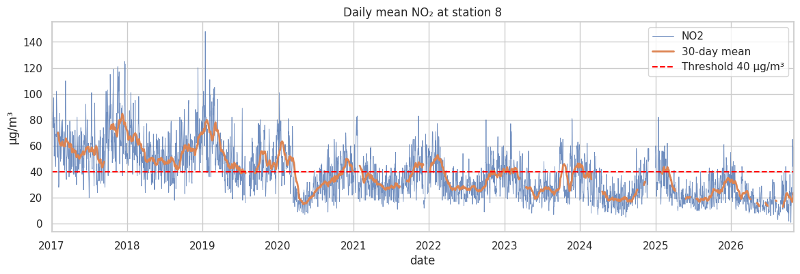
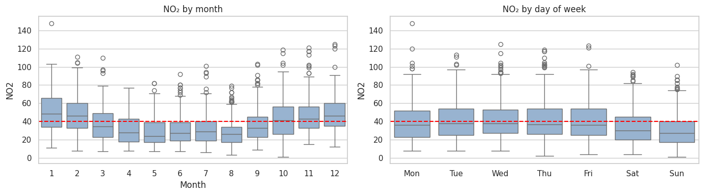
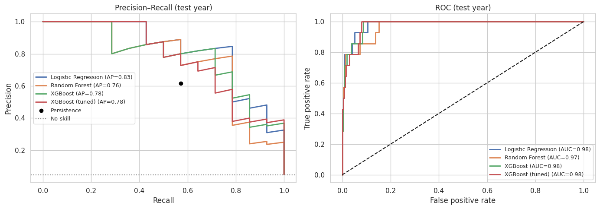
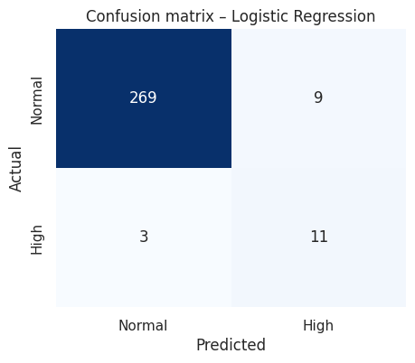
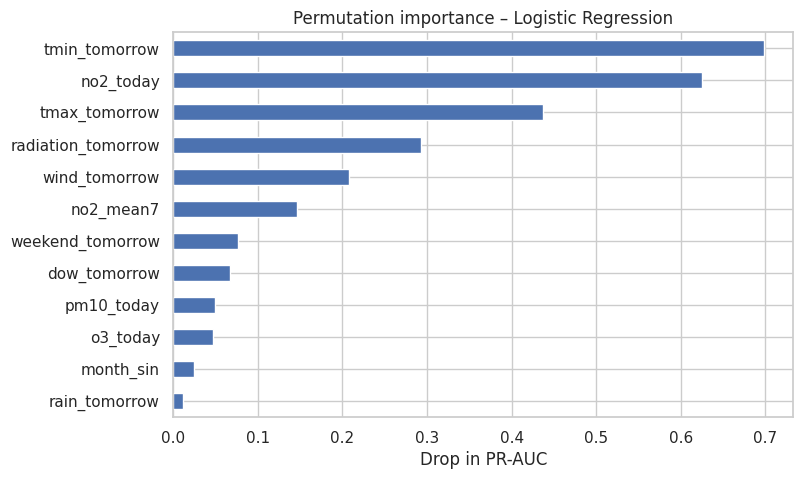

# Predicting high-NO₂ days in Madrid

Will tomorrow be a high-pollution day? This project predicts, one day ahead, whether the daily mean **NO₂** at a Madrid traffic station (Escuelas Aguirre) will exceed **40 µg/m³**, using open air-quality data, weather and calendar information.

## Why it matters

NO₂ comes mainly from road traffic and is the pollutant that most often puts Madrid above air-quality limits. Measures such as speed limits, parking restrictions or public warnings work best when they are announced the day before, so a reliable next-day prediction is useful.

High-NO₂ days concentrate in the cold months and on weekdays:

## Approach

- **Task:** binary classification (high-NO₂ day vs. normal day), with imbalanced classes.
- **Features:** today's and recent NO₂ (lags and 7-day mean), NO, PM10 and O₃, today's and tomorrow's weather (temperature, rain, wind, wind direction, solar radiation) and tomorrow's calendar (day of week, weekend, public holiday, month).
- **Time-aware evaluation:** training on past years, threshold tuning on the next year and a final test on the most recent period. Cross-validation uses `TimeSeriesSplit`, so the model never sees the future.
- **Baseline:** the naive rule *"tomorrow will be like today"* (persistence). A model is only useful if it beats it.
- **Models:** Logistic Regression, Random Forest and XGBoost (plus a randomized hyperparameter search), wrapped in pipelines so imputation and scaling happen inside each fold.
- **Metrics:** PR-AUC as the main metric (better suited to rare events than ROC-AUC), plus F1, precision and recall at a threshold chosen on the validation year.
- **Explainability:** permutation importance measured on the test period.

## Results

Test period: January–October 2026 (14 high-NO₂ days).

| Model | PR-AUC | F1 | Precision | Recall |
|---|---|---|---|---|
| Persistence (baseline) | 0.65 | 0.59 | 0.62 | 0.57 |
| **Logistic Regression** | **0.83** | 0.65 | 0.55 | 0.79 |
| Random Forest | 0.76 | **0.76** | **0.73** | 0.79 |
| XGBoost | 0.78 | 0.65 | 0.52 | 0.86 |

- All models clearly beat persistence: weather and calendar information add real predictive value.
- Logistic Regression ranks high days best (PR-AUC 0.83 vs. 0.65). At its chosen threshold it caught 11 of the 14 high days.
- The strongest signals are tomorrow's temperature, today's NO₂, solar radiation and wind: cold, still days trap pollution.

## Limitations

- The test period is short (one partial year with 14 high days), so metrics are sensitive to a few predictions.
- Tomorrow's observed weather is used as a stand-in for the weather forecast; real forecast errors would lower performance.
- Only one station is modelled.

## How to run

1. Download the yearly daily files of the dataset **"Calidad del aire. Datos diarios desde 2001"** from the [Madrid open data portal](https://datos.madrid.es/portal/site/egob/menuitem.c05c1f754a33a9fbe4b2e4b284f1a5a0/?vgnextoid=aecb88a7e2b73410VgnVCM2000000c205a0aRCRD&vgnextchannel=374512b9ace9f310VgnVCM100000171f5a0aRCRD) (for example, 2015 to the latest year). Older years come as `.zip` files; they can be used as they are.
2. Open `NO2_Madrid_prediction.ipynb` in Google Colab (or locally after `pip install -r requirements.txt`).
3. Upload the files when asked (locally, put them in a `data/` folder) and run all cells. Weather data is downloaded automatically.

The station and the NO₂ threshold can be changed in the configuration cell.

## Data sources

- Air quality: Ayuntamiento de Madrid, open data portal (datos.madrid.es).
- Weather: [Open-Meteo](https://open-meteo.com/) historical weather API (CC BY 4.0).
- Public holidays: [`holidays`](https://pypi.org/project/holidays/) Python package.

## Tech stack

Python · Pandas · NumPy · Scikit-learn · XGBoost · Matplotlib · Seaborn

## Author

Alejandro Cabrera Mateo · [LinkedIn](https://linkedin.com/in/alejandro-cabrera-mateo)
